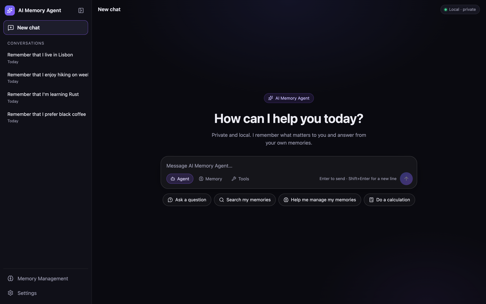
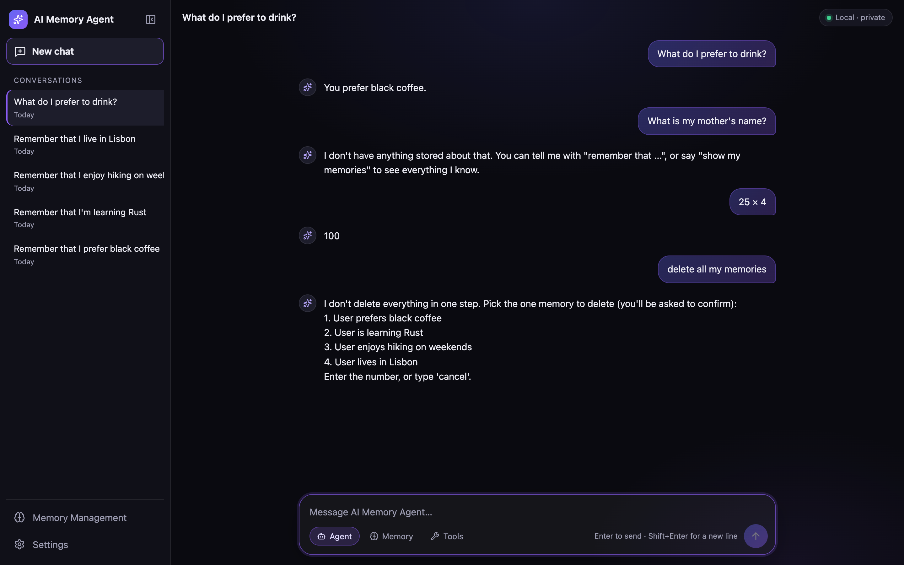
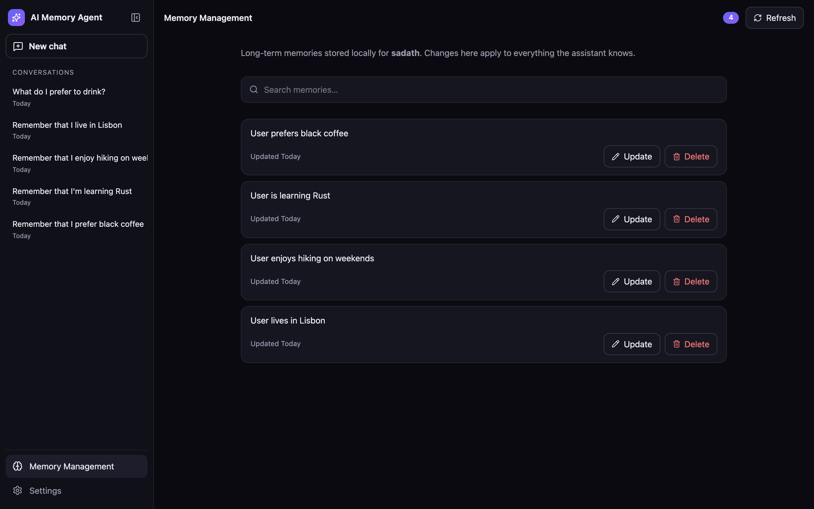
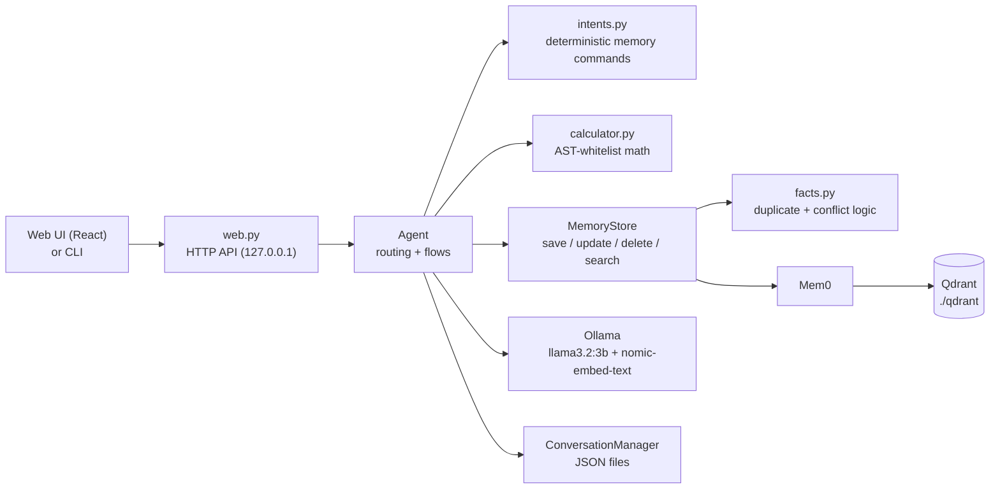

# AI Memory Agent

A **private, local-first AI assistant with verifiable long-term memory**. It runs entirely on your own machine: a local LLM (Ollama), a local vector database (Qdrant) and a local memory layer (Mem0). Nothing is sent to a cloud service.

The interesting part is not that it remembers things, but that it is **honest about what it remembers**: memory commands run real backend functions instead of asking the model, unknown facts are reported as unknown rather than invented, and destructive actions can never happen in bulk or without confirmation.



| Chat grounded in real memories | Memory Management |
|---|---|
|  |  |

*Screenshots use a throwaway synthetic dataset, not real personal data.*

## Features

- **Persistent long-term memory** (Mem0 + local Qdrant): save, list, search, update and delete individual memories.
- **Deterministic memory commands**: "show my memories", "remember that…", "forget…", "search my memories about…" are recognised by pattern (`memory_agent/intents.py`) and executed against the real store. The language model is never asked whether it "has access".
- **Duplicate and conflict handling**: `I love coding` and `User stated they love coding` are recognised as the same fact; contradicting facts (`favorite food: biryani` vs `pasta`) are surfaced and the user is asked, never silently resolved.
- **Grounded answers (RAG)**: only *relevant* memories are given to the model, with guards against the model denying memory access, inventing memories, or repeating stale chat text after an update.
- **Safe deletion**: delete/forget always lists candidates, needs a numbered pick *and* an explicit `yes`; "delete everything" is refused.
- **Independent, persistent conversations** with a ChatGPT-style sidebar. Long-term memories are shared across chats; chat history is not.
- **Safe calculator**: an AST whitelist (no `eval`), with bounds on exponents and sizes. Understands `25 × 4`, `125 ÷ 5`, `12 plus 30`.
- **Graceful failure**: if Ollama or the store is unavailable the UI shows a clear error, keeps your draft, stores no half-finished turn, and recovers without a restart.
- **Web UI and CLI** sharing the same agent code (React + TypeScript + framer-motion; stdlib HTTP server, no web framework).
- **Private by design**: local models, Mem0 telemetry disabled, server bound to `127.0.0.1` with Host/Origin checks.

## The three demos

These are also encoded as automated tests in [`tests/test_demo_scenarios.py`](tests/test_demo_scenarios.py).

**1. Verifiable long-term memory**
1. In a chat say `Remember that I prefer black coffee` → `Saved`.
2. Open **Memory Management** (sidebar) and show the record. Start a **New chat** and ask `What do I prefer to drink?` → answered from the stored memory.
3. In Memory Management click **Update** and change it to *green tea*; ask again in a new chat → the new value.
4. Click **Delete** (a confirmation dialog appears) and ask again → `I don't have anything stored about that`.

**2. Honesty and safety**
1. Ask `What is my mother's name?` → it says nothing is stored instead of guessing.
2. Say `delete all my memories` → refused; it offers one-at-a-time deletion with confirmation, and nothing is deleted until you pick a number and type `yes`.
3. Say `I love coding` twice (or `Remember that I love coding`) → `Already stored`, no second record. Conflicting facts are flagged, not overwritten.

**3. Reliability**
1. Type `25 × 4` → `100` via the safe calculator (hostile input such as `__import__('os')…` is never executed).
2. Create two chats on different topics, switch between them and reload the page / restart the server: each keeps its own messages.
3. Stop Ollama and send a message → an error banner, **your draft is kept**, nothing is half-saved; `show my memories` and the calculator still work. Start Ollama again and send: it recovers without restarting the app.

## Architecture



A message first goes through `intents.py` (memory commands) and the calculator; only open-ended text reaches the model, together with a small set of *relevant* retrieved memories. Saving compares the new statement with **every** stored memory by structured fact (not by raw string), because Mem0/LLMs rewrite wording (`i love coding` → `User loves coding`). Embedding similarity alone is never treated as proof of "same fact" and never decides to overwrite or delete.

## Tech stack

Python · Ollama (`llama3.2:3b`, `nomic-embed-text`) · Mem0 (`mem0ai` 2.0.19) · Qdrant (local mode) · standard-library HTTP server · React 18 · TypeScript · Vite · framer-motion · `unittest`.

## Requirements

- **Python 3.14** (what the pinned `requirements.txt` was produced and tested with).
- **[Ollama](https://ollama.com/download)** running locally with these models:
  ```bash
  ollama pull llama3.2:3b
  ollama pull nomic-embed-text
  ```
- **Node.js** (a recent version; developed with v25) is only needed if you change the UI. The built UI is committed in `static/`.
- Disk space for the two models (about 2.3 GB: `llama3.2:3b` is ~2 GB, `nomic-embed-text` ~0.3 GB) and enough free RAM to run a 3B model.

## Install and run

```bash
git clone https://github.com/sadath-shah/ai-memory-agent.git
cd ai-memory-agent
python3 -m venv .venv && source .venv/bin/activate
pip install -r requirements.txt

ollama serve            # in another terminal, if it is not already running

python main.py --web    # web UI at http://127.0.0.1:8765   (--port to change)
python main.py          # or the terminal interface
```

Qdrant's local mode allows **one process per store**: don't run the CLI and the web server at the same time (the app tells you if you do). Memories are created in `./qdrant` and chats in `conversation_history.json` / `conversations/` on first use; all of these are git-ignored.

To rebuild the UI after editing `frontend/src`:

```bash
cd frontend && npm install && npm run build     # type-checks (tsc) then bundles into ../static
```

## Configuration

Environment variables (no `.env` file is read, so there is no `.env.example`):

| Variable | Default | Purpose |
|---|---|---|
| `MEMORY_AGENT_DATA_DIR` | project folder | Where `qdrant/` and the chat files live (Mem0's own audit DB moves there too when this is set; otherwise it uses `~/.mem0`). Point it elsewhere to use a separate dataset (demos, experiments). |
| `MEMORY_AGENT_USER_ID` | `sadath` | The Mem0 user id memories are stored under. |
| `OLLAMA_HOST` | `http://localhost:11434` | Ollama address. |

Models, the Qdrant collection name (`sadath_memory`) and tuning constants live in [`memory_agent/config.py`](memory_agent/config.py). The default user id and collection name are kept so existing local data keeps working.

## Commands you can type

| Say | Does |
|---|---|
| `show my memories`, `what do you remember about me?` | lists every stored memory (numbered, with a count) |
| `search my memories about coding` | returns only matching memories |
| `remember that I like tea`, `I love coding` | saves a fact (duplicates skipped, conflicts asked about) |
| `Actually, my favorite food is pasta` | corrects a stored fact |
| `update memory`, `edit my memory about food` | pick one by number, then enter the replacement |
| `delete memory`, `forget that I like tea` | candidates → pick a number → type `yes` |
| `find duplicates`, `how many memories do I have?` | read-only reports |
| `what is 12*(3+4)`, `25 × 4` | safe calculator |

The composer also has three real modes: **Agent** (default), **Memory** (memory actions only) and **Tools** (calculator only).

## HTTP API (local)

`POST /api/chat` `{message, mode?, conversation_id?}` (omitted id = original history, `"new"` = start a chat) · `GET /api/conversations` · `GET /api/history?conversation_id=` · `GET /api/memories` · `PUT /api/memories/<id>` `{text}` · `DELETE /api/memories/<id>?confirm=yes` · `GET /api/status` · `GET /api/settings`

## Tests

```bash
python -m unittest discover -s tests -t .                  # 157 tests, no Ollama needed (fake store + fake model)
RUN_INTEGRATION=1 python -m unittest tests.test_integration  # real Mem0 + Ollama, throwaway temp dir
cd frontend && npx tsc --noEmit && npm run build           # type-check + build the UI
```

The unit tests use an in-memory fake store and a scripted fake model, run a real HTTP server, and **never touch `./qdrant`**. They cover memory save/dedupe/conflict/update/delete, intents, conversations, the calculator, the web API and the three demos above. The browser behaviour (composer, sidebar, drafts, mobile layout) was verified manually with a headless-Chrome script that is not part of this repository.

## Project layout

```
main.py                 entry point (CLI, or --web)
memory_agent/           backend: agent, intents, facts, memory_store, conversations, calculator, web, config
frontend/src/           React + TypeScript UI source
static/                 built UI (committed so Python alone can run the app)
tests/                  unit, API and demo-scenario tests
docs/screenshots/       README images (synthetic data)
```

## Known limitations

- A small local model (3B) is weak at free-form routing and long reasoning, which is why memory commands and the calculator are rule-based.
- "Relevant memory" for purely semantic questions uses a score cutoff measured on one small dataset (`SEMANTIC_RELEVANCE`); a true memory phrased very differently from the question may be answered with "nothing stored".
- After changing or deleting a memory, the model may still quote what *you said earlier in the same chat*; a new chat starts clean.
- Single-user, single-process by design (Qdrant local mode). No authentication: it is meant for `127.0.0.1`.
- No conversation delete/rename, no markdown rendering; the UI was tested in Chrome only.
- `facts.py` understands common English statements (`I love…`, `my X is Y`); unusual phrasing falls back to word overlap and asks rather than guessing.

## Privacy

Everything runs locally; the only network use is installing dependencies and pulling Ollama models. Mem0's anonymous telemetry is disabled in `config.py`. Your memories and conversations are stored in git-ignored local files.
